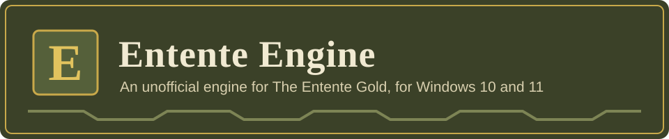

<p align="center">
  
</p>

<p align="center">
  <a href="https://github.com/supm3n/trench-engine/releases/latest"></a>
  
  <a href="LICENSE"></a>
</p>

**Entente Engine** is an unofficial, home-made engine for the strategy game **The Entente Gold** (Lesta Studio,
2003). It plays the same game, with the same maps, pictures, sounds and missions, on today's Windows 10 and 11,
without a compatibility wrapper. Along the way it fixes many of the old game's crashes and bugs, adds comforts such
as any window size and mouse wheel zoom, and runs big battles more smoothly. For players who want something new,
there is an optional rule set, **Entente Engine Plus**; the standard rules stay as they were.

It is a free hobby project. Its own menus are in English, German, Italian and Russian; mission texts and
briefings come from your copy of the game (English on Steam). Versions are numbered by
year: 2026.1 is the first release of 2026.

<p align="center">
  
</p>

> [!IMPORTANT]
> **You need your own copy of The Entente Gold**, for example from Steam. Entente Engine contains none of the game's files: no pictures, sounds, maps or mission texts. It reads them from your own copy of The Entente Gold. To play the same game, the code does include some numbers from the original program (such as research prices and shell values) and the few words painted on the game's buttons, which it translates for the menus. It never changes the game's own files, and the original game keeps working as before.

## Download and install

1. Download the zip file of the newest version from the
   **[Releases page](https://github.com/supm3n/trench-engine/releases)** and unzip it.
2. Put `EntenteEngine.exe` into the game's folder, next to the original `Antanta.exe` (in Steam: right-click the game,
   **Manage**, **Browse local files**).
3. Double-click it. On the first start Windows may warn about a new, unsigned program: click **More info**, then
   **Run anyway**.

Entente Engine finds your copy of the game by itself (Steam included) or asks you once for its folder. The full
guide, with network play, saves, updating and a troubleshooting list, is in **[docs/INSTALL.md](docs/INSTALL.md)**.

## Highlights

| | What you get | Details |
|---|---|---|
| **Fixed** | Crashes and freezes of the original that cannot happen here, among them the well-known frozen mouse and the 8-player start crash. Saves that keep everything. Many gameplay, mission, sound and drawing bugs. | [Features](docs/FEATURES.md#crashes-and-freezes) |
| **Comfort** | Any window size, widescreen and full screen; interface scale for big screens; smooth scrolling; mouse wheel zoom; network games for up to 8 players with rejoin and autosave. | [Features](docs/FEATURES.md#interface-and-comfort) |
| **Faster** | About half the original's time per game turn on the same saves and PC, full game speed up to the biggest save measured (86,415 units), and far less stutter. | [Features](docs/FEATURES.md#performance) |
| **New: Plus** | An optional skirmish rule set: a reworked economy and research list, the Building Academy, counter-battery fire, a smarter computer army and call-in strikes. | [Entente Engine Plus](docs/PLUS.md) |

<p align="center">
  
  
  
</p>

## Verifying your download

Each release lists the SHA-256 of `EntenteEngine.exe`. In PowerShell:

```powershell
Get-FileHash .\EntenteEngine.exe -Algorithm SHA256
```

The release build is reproducible: the same source and the same toolchain give the same bytes, whatever folder you
build in. So you can also build the release yourself and compare the two fingerprints
([how](docs/BUILDING.md#check-a-release-against-your-own-build)).

Entente Engine never updates itself; new versions are downloaded by hand from the Releases page. At each start it
asks GitHub (api.github.com) whether a newer version is out and, if so, only tells you. To turn that off, set
**Check for updates** to Off in Game options. More in [SECURITY.md](SECURITY.md).

## Building from source

The exe is built with a pinned toolchain (CMake, Ninja and llvm-mingw, each checked by SHA-256) and two commands on
Windows 10 or 11. See **[docs/BUILDING.md](docs/BUILDING.md)**.

## Licence

Entente Engine's own code is under the **PolyForm Strict License 1.0.0** ([LICENSE](LICENSE)). In plain words: you
may use it for any non-commercial purpose, such as playing the game and reading and checking the code. You may not
share copies of it (please share a link to this page instead) and you may not make changed versions. The licence
covers our code only. The game's files belong to their owners, and the libraries we use keep their own licences
([THIRD_PARTY.md](THIRD_PARTY.md)).

## Bugs and ideas

Bug reports and ideas are welcome on the [Issues page](https://github.com/supm3n/trench-engine/issues). Because of
the licence, we cannot accept pull requests with code for now; see [CONTRIBUTING.md](CONTRIBUTING.md).

## Not affiliated

Entente Engine is an independent fan project. It is **not affiliated with or endorsed by Lesta or ESDigital**. All
rights to The Entente Gold belong to their owners.

"Antanta" (the original program's own name) appears in this code only as an internal name for folders, build targets and
namespaces. The product is Entente Engine.

## Credits

Made by supm3n with Claude (Anthropic).

The Entente Gold was made by Lesta Studio. This project exists because it is a game worth playing again.

Entente Engine is built on free software made by other people: SDL, SDL_ttf, SDL_mixer, libogg and libvorbis,
FreeType, zlib, Lua, fdlibm, pl_mpeg, IXWebSocket and the Black Ops One and Liberation fonts. Thank you. The list with
versions and licences is in [THIRD_PARTY.md](THIRD_PARTY.md).
